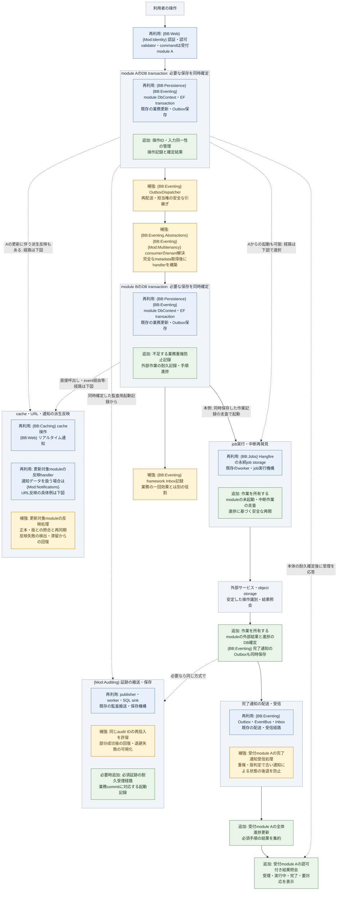
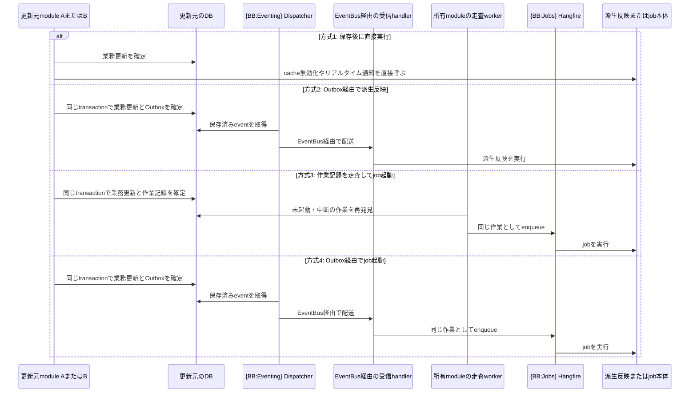
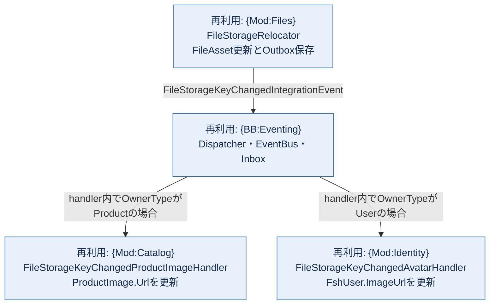
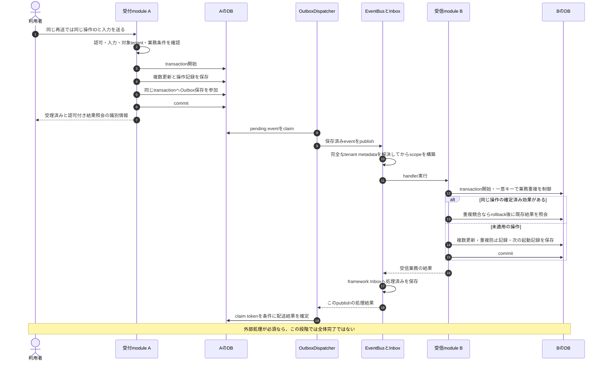
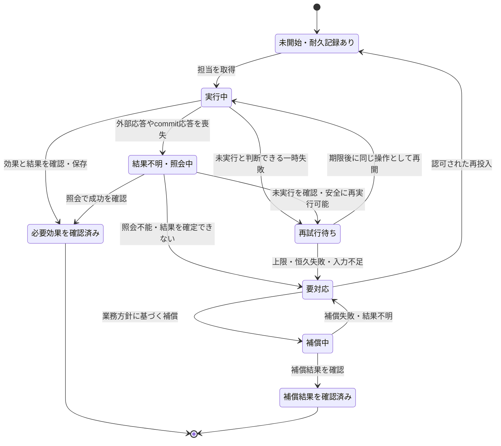

# 複雑な書き込み処理を安全に完了させるゴールイメージ

作成日: 2026-10-15

## この資料の位置付け

本書は、一つの利用者操作から複数module・DB・外部サービスへ処理が広がる場合について、**どの保存を一体にし、何を記録して引き継ぎ、どこで完了と判断するか**を示します。その流れに沿って、現在の機能部品と、適用修正・補強・追加が必要な部品を対応付けます。

現状の基準はコミット`a967537526f3b769c7d268da3ed2a6920af65ce9`を調べた[詳細調査結果](data-write-quality-investigation-results.md)です。**図は将来の目標構成であり、そのまま実装されている処理の呼出図ではありません。** 新規名は仮称です。本書の作成に伴うアプリケーション・BuildingBlocks・DB・Skillsの変更はありません。

## 目次

1. [提示されたシナリオに、何を補う必要があるか](#scope)
2. [代表シナリオの全体像](#overview)（[後続の起動経路](#follow-up-routing)・[派生反映の具体例](#derived-reflection-example)）
3. [保存境界と実行順序](#transactions)
4. [層ごとの既存部品と不足](#layers)
5. [追加する記録と、全体完了の判断](#completion)
6. [止まった場合の回復と結果不明](#recovery)
7. [このゴールを満たしたと判断する条件](#acceptance)
8. [実装へ進める単位と関連資料](#implementation)

## 1. 提示されたシナリオに、何を補う必要があるか

**「利用者操作 → command → module内の複数更新 → Outbox/Inbox → 他moduleの更新」は、複雑な書き込みを考える中心的な代表形です。ただし、それだけをアプリ内で唯一の『最も複雑な形』とは言えません。** module数が少なくても、残高の同時加算や最後の管理者の削除禁止など、競合時の業務条件が難しい処理もあります。

複数moduleへ広がる代表形には、少なくとも以下を重ねて考える必要があります。

| 補う観点 | 増える処理・判断 |
|---|---|
| DBの外の変更 | blobの作成・削除、メール、Webhook、Redisのquota等。DBのrollbackでは元に戻らない。 |
| 複数の後続と連鎖 | 一つのeventに複数handlerがあり、さらに別のeventやjobを起動する。一部だけ完了した状態が生まれる。 |
| tenantと物理DB | moduleが違うことと、DBが違うことは別。catalog・共有DB・専用tenant DBのどれへ作用するかを決める。 |
| 並行操作・重複・逆順 | 同じ操作の再送、別操作の競合、古いeventの遅着を、それぞれ別に扱う。 |
| 長時間処理と停止 | commit後の応答喪失、enqueue前の停止、worker交代、外部成功後の記録失敗から回復する。 |
| 全体完了の確認 | Outbox配送完了ではなく、どの後続が必須で、どこまで終われば利用可能かを判定する。 |
| 証跡・派生状態・運用 | 必須監査、cache・URL等の再同期、隔離後の警告・再投入・保持をつなぐ。 |
| 時間経過と復元 | event形式や業務ルールの更新、記録の保持期限、backup復元後も、古い仕事を正しく扱う。 |

また、入口は利用者のcommandに限りません。定期job、外部callback、統合event、管理者の再投入から始まっても、受理後の保存・回復に必要な原則は同じです。

### このアプリに既にある、複雑さの具体例

Filesの保存先変更は、実例として近い構造を持ちます。`FileStorageRelocator`はobjectのコピー、FileAsset更新とOutbox保存のtransaction、commit後の旧object削除を扱います。[実装][relocator]

そのeventを受けて、所有種別に応じてCatalogの商品画像URL、またはIdentityのavatar URLを更新するhandlerがあります。**一つのファイル変更で両moduleの更新が常に必要という意味ではありません。** [Catalog側][product-url]・[Identity側][avatar-url]

この例にも、外部objectとDBの境界、後続URL更新、重複・逆順、consumerのtenant接続、削除後の回復という別々の論点があります。単に「複数moduleが更新できる」だけでは、全体の安全性の説明になりません。

## 2. 代表シナリオの全体像

以下では、利用者が一つの業務操作を要求し、受付module Aの複数更新、受信module Bの複数更新、外部処理を経て全体が完了する形を扱います。必要なら受信module C等へ分岐するものとします。

**A・Bは説明用の役割名です。Identity・Multitenancy・Billing等が、この順序で一つの機能を実装済みとする図ではありません。** すべての機能に、以下の全段階や新しい操作管理を必須とするものでもありません。

### 図の読み方

- **再利用（青）**: 既存部品を使う。機能側の適用修正は必要になり得る。
- **補強（橙）**: 既存部品の契約・実装を直す。
- **追加（緑）**: 現状では共通提供されていない記録・連携を、必要な業務に設ける。

複数の区分を組み合わせる処理は、外枠の中に詳細枠を置いて分けています。詳細枠と単独の機能枠には、同じ色分けを適用します。外枠、利用者、外部システムは区分を表さない灰色です。再利用する部品も、transaction参加などの機能側の適用修正は必要です。

`{Mod:対象名}`はmodule、`{BB:対象名}`はBuildingBlockの識別情報です。複数に関係する場合は併記し、外枠だけに付けた識別情報は内側の詳細枠にも適用します。タグは関連部品の所在を示し、必ずそのBuildingBlock自体を改修するという意味ではありません。例示のmodule A・Bが所有する業務処理、および利用者・外部システムには実在moduleのタグを付けません。

詳細枠の横並びは実行順序や並列実行を示すものではありません。A・Bの外枠はDBの保存境界ですが、それ以外の外枠は処理のまとまりであり、外部IOまでを一つのtransactionに含める意味ではありません。

主線ではBが外部作業を持つ例を示しています。Aからの点線は別の構成も選べることを示し、一つの操作で両方の経路を必ず実行するという意味ではありません。jobと派生反映の起点は、**AかBかではなく、正本の更新と必要な後続処理を所有するmodule**によって決まります。これらの矢印は業務上の依存関係であり、transactionの中から直接起動することや、Outboxの自動実行を示すものではありません。

分岐があれば、B以降を必須の後続ごとに持ちます。完了通知も、元の要求と同じ配送・受信の安全策を通します。図のInbox記録はBのDB transactionと自動的に一体になるものではありません。

**HTTPで要求を受理したこと、本体DBが保存されたこと、eventが配送されたこと、すべての必須業務が完了したことは、別の到達点です。**

### 後続処理の起点と起動経路

全体図の「job実行」と「派生反映」への矢印は、以下のような経路に展開します。**更新元はmodule A・Bのどちらでもよく、後続処理ごとに方式を選びます。** 同じ操作でも、任意の画面通知は直接呼び、必須の後続更新はOutboxで渡す、という組合せがあり得ます。

次の図は起動経路の比較であり、四方式を順番に実行する図ではありません。受信側のDB更新・tenant解決・重複防止等は全体図で示したものを適用し、ここでは省略しています。

| 方式 | Outbox・eventは間に入るか | 失敗・再実行で補うこと |
|---|---|---|
| 1. 保存後に直接実行 | 入らない。 | commit後・呼出し前の停止は別途再同期等で回復する。必須作業を失ってよい理由にはしない。 |
| 2. Outboxで派生反映 | 入る。Outbox → Dispatcher → EventBus → handler。 | 業務とOutboxの同時確定、受信側の重複・順序制御、未反映の回復。 |
| 3. 作業記録を走査 | Outboxは必須でない。作業記録が耐久的な引継ぎを担う。 | 未起動の再発見、担当権、重複enqueueを許容するjob、手順効果と進捗の整合。 |
| 4. Outboxでjob起動 | 入る。ただしeventの受信先はjobを起動するhandler。 | enqueue後・処理済み記録前に止まるとjobが重複し得る。Inboxだけに頼らずjob側も同じ操作へ収束させる。 |

**Outboxは起動要求の耐久的な引継ぎ、Hangfireはenqueueされたjobの実行を担い、代替関係ではありません。** 全体図のBからjobへの主線は方式3を選んだ目標例です。方式4を選ぶなら、BのOutbox → 配送 → 起動handler → Hangfireという経路に置き換えます。派生反映の矢印は方式1・2等を省略しており、直接実行に固定したものではありません。

現状の実装がすべて上記の安全策を満たすわけではありません。例えば、[初期構築][provision]は進捗保存後に直接enqueueしており、方式3のような未起動回復が完成済みという意味ではありません。[ChatのSignalR通知][chat-send]は保存後の直接呼出しです。また、Outboxに保存せずEventBusへ直接publishする経路もあり、それは方式2の耐久引継ぎとは区別します。

### 派生反映の具体例: Filesの変更をCatalog・Identityへ反映する

全体図の**「更新対象moduleの反映handler」**の実装例として、Filesでファイルの保存先が変わったとき、他moduleが保持するURL参照を更新する経路を取り上げます。

Filesはファイルの保存先を管理しますが、そのファイルを利用する商品画像やユーザーavatarのURLは、それぞれの業務moduleのDBにも保持されています。保存先の変更に追随するため、Catalogには`ProductImage.Url`を、Identityには`FshUser.ImageUrl`を更新するhandlerがあります。

この例では、**配送・cache操作等の共通機構と、反映対象の業務データを所有するmoduleを区別します。** CatalogとIdentityは後者です。Identityは認証・認可も提供しますが、ここではavatar参照の所有者として扱います。各部品の役割は次のとおりです。

| 種類 | 対象 | この説明での役割 |
|---|---|---|
| 共通の技術部品 | `{BB:Caching}` | cacheの取得・保存・無効化等。どの正本の変更で何を無効化するかは業務側が決める。 |
| 共通の技術部品 | `{BB:Web}` | SignalR等によるリアルタイム通知。通知先・内容・業務完了の意味は呼出元が決める。 |
| 通知データの所有module | `{Mod:Notifications}` | 通知record等を扱う場合の反映先。すべてのcache更新・SignalR送信がこのmoduleを通るわけではない。 |
| 業務データの反映先の例 | `{Mod:Catalog}` | ファイルを参照する商品画像のURLを更新する。 |
| 業務データの反映先の例 | `{Mod:Identity}` | ファイルを参照するユーザーavatarのURLを更新する。 |

次は**現在あるURL反映経路の具体例**です。青は既存部品を示すもので、tenant・順序・配送等の保証がすべて完成しているという意味ではありません。

EventBusがOwnerTypeで振り分けるという意味ではなく、登録されたhandlerが内部で対象種別を判定します。CatalogはFileAsset IDに対応する商品画像を、Identityは対象ユーザーのavatarを確認します。両方の更新が常に発生するわけではなく、ここで`Caching`や`Notifications`を必ず経由するわけでもありません。[Catalogのhandler][product-url]・[Identityのhandler][avatar-url]

この例では、全体図の**「更新対象moduleの反映handler」**にCatalog・IdentityのURL更新handlerが対応します。別の業務moduleでも、同じように自分が所有する派生データの更新を担当し、必要に応じてCachingやWeb等の共通部品を利用します。

## 3. 保存境界と実行順序

### 一体にするのは「同じDB内の必要な確定」

| 保存境界 | 一緒に確定するもの | その外側に置くもの |
|---|---|---|
| 受付module Aのtransaction | Aの複数更新、必要な操作記録、後続起動のOutbox。必須証跡が対象ならその起動記録も含む。 | 他DBの更新、job実行、外部IO、利用者への応答。 |
| 受信module Bのtransaction | Bの複数更新、業務側の重複防止、外部作業の耐久記録や次のOutbox。 | framework Inboxの独立保存、外部実行。 |
| 外部結果を受けたBのtransaction | 確認した外部結果、手順進捗、必要な完了通知のOutbox。 | 外部サービス側での実際の確定。そこは外部の契約で照会・重複排除する。 |
| 完了通知を受けたAのtransaction | 通知の重複・版判定、該当手順の状態、全体状態。 | 他の未完了手順。通知を受けただけで一律に全体完了にしない。 |

Outboxが別DbContextでも、同じ物理DB・接続のtransactionへ参加できる既存機構はあります。しかし、**別moduleだから自動参加するのでも、同じDBだから自動的に一体になるのでもありません。** 呼出元のtransaction開始、contextの接続共有・参加を確認します。[既存の参加処理][outbox-enlist]

### 受付から受信DB保存までの目標順序

以下は、module側の業務制約・重複防止記録を採用する案です。framework Inboxの保存境界を直す案と混同しないよう、独立保存を図に残しています。

重複分岐で正常扱いにできるのは、該当操作の確定済み効果を確認できた場合です。接続障害、timeout、無関係な制約違反を重複として扱いません。Inbox保存前に停止しても、Bの業務効果を再度発生させず、再配送時に記録を収束させることが狙いです。

また、図は既定のInMemory busに近い目標経路です。RabbitMQ等へ切り替える場合、brokerへのpublish成功はhandler完了を意味しません。confirmation、routing、consumerの受信・再試行・acknowledgementは別途契約・検証が必要です。

## 4. 層ごとの既存部品と不足

修正・追加の対象を、次の三つの列に分けます。**共通部品を直す作業と、それを各機能で正しく使う作業は別であり、同じ行の複数列が必要になる場合があります。**

- **Module横断の共通部品**: BuildingBlocksや、複数moduleから利用する共通機能・契約の変更。Auditingの共通保存経路もここに含め、実装場所を併記します。
- **Module内の共通部品**: 一つのmodule内で、複数の入口・handler・jobが共有するservice、記録・回復機構等の変更。
- **個別機能の実装・適用**: handler等での既存部品の使い方、業務ルール・保存境界・成功条件、機能固有のrecordやeventの追加。単なる呼出方法の修正だけに限りません。

`—`は、本書の初期案ではその区分の共通部品変更を要求しないことを示します。「既存実装のままで、その機能の保証が成立している」という意味ではありません。「必要時」「共通化候補」は条件付きの案です。また、特定業務のeventとconsumerを一緒に直す場合は、複数moduleへ影響しても、汎用的な共通部品の改修とは区別して個別機能の列に記載します。

### 4.1. 入口と、最初のDB保存

| 処理層 | 現在ある機能部品 | 共通部品の修正・追加（Module横断） | 共通部品の修正・追加（Module内） | 個別機能の実装・適用 |
|---|---|---|---|---|
| UI・API入口 | ReactのAPI呼出し・Query、認証・permission、Mediator command、validator。 | —。共通の操作受付frameworkの新設は前提にしない。 | —。進捗照会等を複数機能で共用できる場合だけ、module内serviceへの集約を検討する。 | 必須後続がある操作では受理と全体完了を分ける。再送時の操作ID維持、認可付き結果照会、必要なら進捗表示を追加する。 |
| HTTP再送対策 | `Web\Idempotency\IdempotencyEndpointFilter.cs`の応答cache・予約。 | 必要時: filterの入力fingerprint照合・予約延長等を別課題として改修する。業務の一回効果は、この改修の有無に依存させない。 | 共通化候補: 同じmoduleの複数操作で契約が一致する場合の操作記録・照会service。初期案では汎用化を必須にしない。 | 業務操作IDと入力同一性をDBで管理する。同じIDで異なる入力を拒否する。commit後・cache保存前の停止は、操作結果の照会等で扱う。 |
| 業務判断 | domainの検査、validator、一部の一意制約・状態ガード。 | —。汎用の検査・ロック部品の新設は前提にしない。 | 同じ不変条件を複数の更新経路が扱う場合は、domain/serviceに判定と更新を集約する。 | 正しい期間・計算・対象状態を決め、異なる操作の加算や集合条件を保護する。transactionだけで読取競合が解消するとはしない。 |
| 複数更新の保存 | EF transaction、`Persistence\ScopedDbConnectionProvider.cs`、`AmbientDbTransactionRegistry.cs`。 | —。既存の接続共有・transaction参加を再利用し、新しい汎用UnitOfWorkは追加しない。 | 同じ更新を複数の入口が使う場合は、そのmoduleのserviceで保存境界を共有する。共通transaction wrapperの新設自体は必須でない。 | handler/service側でtransactionを開始し、内部保存するmanagerも含め全結果を確認する。同じcontext・接続への参加と途中失敗時のrollbackを実証する。 |
| 後続の起動記録 | `Eventing\Outbox\EfCoreOutboxStore.cs`の保存・transaction参加。 | —。保存側は既存の参加機構を使う。配送・担当権の共通改修は4.2で扱う。 | 同じ業務更新を複数経路が呼ぶ場合は、業務保存と起動記録を一体にするmodule serviceへ集約する。 | 業務更新とOutboxを同時確定するよう呼出元を修正する。必要なら操作ID・手順ID・版をその業務のevent契約とconsumerへ追加する。直接publishやローカルdomain eventだけに必須作業を任せない。 |

BuildingBlocksのパスは`src\BuildingBlocks\`からの相対パスです。操作IDはcorrelation IDとは分けます。入力同一性の判定にも秘密値を平文保存せず、単純なhashを残せばどんな入力でも安全とする設計にはしません。

### 4.2. 配送と、受信moduleのDB保存

| 処理層 | 現在ある機能部品 | 共通部品の修正・追加（Module横断） | 共通部品の修正・追加（Module内） | 個別機能の実装・適用 |
|---|---|---|---|---|
| 送信元DBの選択 | `IEventingDrainScope`、Multitenancyの`FinbuckleEventingDrainScope`。 | —。既存の送信元DB選択を維持し、consumer側のtenant契約とは分ける。 | —。 | 各構成でどのDBのOutboxへ保存・drainするかを確認する。consumerの接続選択とは別に検証する。 |
| 配送・担当権 | `OutboxDispatcher`、`IOutboxStore`、`EfCoreOutboxStore`、`OutboxMessage`。claim、有限retry、隔離・redriveのstore API。 | Eventingのclaimごとのtokenと条件付き結果更新を追加し、旧workerの上書きを防ぐ。必要ならlease更新も追加する。隔離・再投入の公開操作と観測を整備する。 | —。Eventingの担当権処理を各moduleへ重複実装しない。 | 長時間処理・外部二重効果への対策を選ぶ。再投入で業務効果が増えないことを確認し、隔離後の警告・対応責任を決める。 |
| consumerの作用先 | `Eventing.Abstractions\IEventTenantScope.cs`、`InMemoryEventBus`、`FinbuckleEventTenantScope`。 | Eventingの同期`Begin`契約とMultitenancyのadapterを、完全なtenant metadataを非同期解決する契約へ補強する。handler・Inbox・DbContext構築前に適用し、未知tenantを既定DBへ流さない。 | —。共通dispatch契約の責務として扱い、各handlerに同じtenant解決を重ねない。 | 共有DB・専用DB・global eventの対象条件を確認し、各consumerが正しい接続とtenantで動くことを検証する。 |
| 配送の処理済み判定 | `Inbox\EfCoreInboxStore.cs`、`IInboxStore`。handler後のmarker保存。 | `EfCoreInboxStore`の包括的な`DbUpdateException`抑制をやめ、対象の一意制約違反だけを重複と判定する。[現状の呼出順][event-bus]・[Inbox保存][inbox-store] | —。module側の業務重複防止は次の行で分けて扱う。 | 現在のInboxだけで業務効果とmarkerが同時確定するとは扱わない。marker保存前の停止・再配送で業務効果が増えないことを確認する。 |
| 受信業務の一回効果 | 受信handlerとmodule DbContext。業務によっては既存の一意キーや条件付き更新。 | —。初期案では、全handlerを包む共通の受信transaction部品を追加しない。 | 複数consumerで必要なら、module所有の`AppliedIntegrationEvent`等と保存処理を共用する。既存の業務一意キーで足りる場合は新設しない。 | 重複防止記録または業務一意キーと業務効果を、同じmodule DBのtransactionで確定する。同義eventが別IDで来る場合は業務操作IDも使う。 |
| 順序・分岐・次の起動 | 個別handlerでの状態確認・更新。URL置換等にも個別の判定がある。 | —。汎用の全event順序制御・分岐管理engineの新設は前提にしない。 | 同じ状態を複数handlerが更新する場合は、版判定・状態遷移をdomain/serviceに集約する。 | 古いeventを判定し、必要な次のevent・job起動記録を受信業務と同時確定する。複数handlerが一つの共通transactionで動くとはしない。 |

担当権tokenの追加候補は、`Eventing\Outbox\`の上記4ファイルとEF configurationです。schema変更は`src\Host\FSH.Starter.Migrations.PostgreSQL\Eventing\`で扱い、既存のDbMigrator・`EventingDbInitializer`経路で必要なDBへ適用します。

consumerのtenant契約変更はBuildingBlocksだけでは閉じません。`src\Modules\Multitenancy\Modules.Multitenancy\Services\FinbuckleEventTenantScope.cs`、既定の`NullEventTenantScope`、DI登録、契約を使うテストも一緒に整合させます。

### 4.3. DBの外へ進んだ後と、全体の回復

| 処理層 | 現在ある機能部品 | 共通部品の修正・追加（Module横断） | 共通部品の修正・追加（Module内） | 個別機能の実装・適用 |
|---|---|---|---|---|
| jobの起動・実行 | Hangfireの永続storageとworker。Multitenancyの既存provisioning・step記録。 | —。既存Jobs基盤を使い、新しいjob engineは追加しない。Outboxで起動する場合は4.2の補強を使う。 | 所有moduleの耐久作業record・未起動走査・回復jobを整備する。Multitenancyでは既存provisioning・step記録とserviceを拡張し、別の汎用workflow表を重ねない。[現状][provision] | 業務更新と起動記録を同時確定する。各手順を重複jobでも安全にし、効果と進捗のずれを回復する。初期構築の秘密入力等も再開契約に含める。 |
| 外部IO | storage service、HTTP resilience、メール・Webhookの個別実装。Filesの移動・清掃処理。 | この案では一律の新規部品は追加しない。外部結果の「不存在・成功・確認不能」を既存公開契約で区別できない場合は、該当Storage等の共通契約改修を別途設計する。 | 共通化候補: 同じmoduleの複数機能が使う外部作業・清掃record、worker、結果照会adapter。対象keyと進捗を保持する。 | 安定した外部操作キー、結果照会、再実行・補償・孤児回収を設計する。相手が非対応なら保証外と要対応を明示する。 |
| 全体進捗・完了集約 | 一部の業務進捗や状態照会。全操作を覆う汎用の完了管理部品は確認していない。 | —。全module共通の操作DbContext・Saga engineは初期案に含めない。 | 共通化候補: 所有moduleの進捗照会・未完了走査・通知集約service。既存の業務進捗を優先して拡張する。 | 必要な操作・必須手順の状態、完了通知または正本照会を追加する。どの手順の成立で全体完了かを定め、Outbox配送済みだけで完了にしない。 |
| 監査 | Auditing moduleの`ChannelAuditPublisher`、`AuditBackgroundWorker`、`SqlAuditSink`、`FileAuditDlqSink`。 | 実装先はAuditing。sinkの重複許容、tenant別の部分成功後の再投入、退避失敗の可視化を改修する。必要時は耐久受理契約・経路と試行／最終commitの区別を整える。[現状][audit-sink] | 必須監査を複数の更新経路が使う場合は、発行元module内で監査用起動記録の保存を共用する。Auditingのsink処理を各moduleに複製しない。 | 必須証跡の対象と受理点を決め、業務transactionへ起動記録を参加させる。任意診断との違い、記録不能時の応答・完了条件を決める。 |
| 派生状態・表示 | cache無効化、quota、SignalR、URL反映等。 | —。既存Caching・Web等を再利用する。汎用の自動再同期機構があるとは扱わない。 | 同じ派生データを複数経路で更新する場合は、そのmoduleの反映・再計算serviceや照合jobを共用する。 | 正本・版・許容遅延を決め、反映handlerで失敗を検出し、再同期する。通知送信済みを、利用者が正しい値を取得できることと同一視しない。 |
| 回復・保持・運用 | log・metrics、Outboxの隔離・再投入API、個別保守job。 | Eventing等の共通基盤では、隔離・再投入の認可付き公開操作と滞留の観測を整える。配送・担当権の行と同じ作業であり、別の基盤を重ねない。 | 所有moduleの照会・再開・補償・保持処理と未完了走査を共用する。 | 操作ごとの再投入可否、旧eventの読取・移行・隔離、重複記録の保持、復元後の照合を定める。警告先・担当・期限を運用として決める。 |

HTTP・job・Outboxのretryを重ねると、外部呼出回数が増えます。PostgreSQLの共通設定ではDB実行retryは有効化されておらず、機構の存在だけで全IOを再試行すると考えません。再試行対象・上限・結果不明の扱いを、層をまたいで決めます。

## 5. 追加する記録と、全体完了の判断

### 欠けているのは、万能transactionより「後から判断できる記録」

本シナリオで必要なら、以下を業務の所有moduleに置きます。すべてを新しい共通DBに集める案ではありません。

| 記録の案 | 最小限に残す内容 | 何に使うか |
|---|---|---|
| 操作record | tenant・操作種別・操作ID、必要なcaller境界、入力同一性、状態、確定結果・版、時刻。 | 同じ再送と別操作の区別、応答喪失後の照会、全体状態の正本。 |
| 手順record | 操作ID・手順ID、必須か任意か、未開始・進行・結果、試行・次回実行、最終エラー。 | 分岐の未完了発見、再開、どの後続で止まったかの説明。既存の進捗が足りるなら拡張する。 |
| 業務重複防止 | eventまたは操作の識別と処理種別、一意制約、必要な結果参照。 | 受信DBの業務効果を一回に収束させる。業務効果と同じtransactionで保存する。 |
| 外部作業・清掃record | 対象key、安定した外部操作キー、状態、照会に必要な情報、試行・次回実行。 | 外部成功後の記録失敗、削除失敗、結果不明からの回復。 |
| 完了・失敗通知のOutbox | 操作ID・手順ID、結果、版、必要な公開情報。 | 結果保存と同時確定し、受付側へ耐久的に返す。correlationだけで通知を集約しない。 |

保持するのは再開に必要な最小情報です。平文password等をjob引数・Outbox・進捗へ追加しません。初期構築は既存の一回消費password bufferも踏まえ、安全な資格情報設定や再入力の契約を別に定めます。

### 誰が「全部終わった」と言うのか

全体状態が必要な機能では、**受付module等の明示した業務所有者**を決めます。OutboxDispatcher、Inbox、Auditingを全体完了の判定者にはしません。

その所有者は「配送済み件数」ではなく、必要な手順集合と、各手順の業務結果を判定します。必須B・Cへの分岐があるなら、Bの完了だけで全体を完了にしません。後から来た古い失敗通知で確定済み状態を後退させないよう、版・状態遷移も保護します。

| 到達点 | 判断の意味 |
|---|---|
| 受理済み | 本体と必要な起動記録が耐久確定した。まだ必要な後続が残る。 |
| 業務完了 | その機能が必須と定めたDB効果・外部結果・証跡受理等が成立した。 |
| 後処理中 | 業務完了後でもよい清掃・派生反映が残る。これを許すかは機能ごとに決める。 |
| 要対応 | 自動回復で完了できず、人の判断・入力・補償を待つ。成功ではない。 |

例えばメールproviderの受理と、利用者の実受信・確認は異なります。監査も「起動記録の耐久受理」と「最終監査DBへの保存」のどちらを業務完了条件にするかを決めます。すべてを無条件に待つ設計にも、すべてを任意扱いする設計にもしません。

一つの正本を認可付きで照会すれば十分な小さい機能では、操作recordや完了通知は不要です。全体の操作管理を全commandへ追加することが目的ではありません。

## 6. 止まった場合の回復と結果不明

### 外部作業を持つ一手順の目標状態

これは必要な意味を示す図です。既存の全entityに同じenumを追加する指定ではありません。

「補償」は全体rollbackではありません。既に送ったメールは取り消せず、返金も元の取引を消すこととは異なります。補償後は元の業務が成功した状態とも区別します。

### 停止点と回復の対応

| 停止・競合 | 残すべき材料と回復 |
|---|---|
| Aの複数保存の途中 | 同一transactionをrollback。別contextの保存だけが残らないことを確認する。 |
| Aのcommit後、HTTP応答前 | 同じ操作IDで確定結果・進捗を照会。加算等を新しい操作として繰り返さない。 |
| Aの保存後、後続起動前 | 同時保存したOutboxまたは耐久作業から再発見する。メモリ通知だけを頼らない。 |
| Bのcommit後、Inbox保存前 | Bの業務制約・重複防止で効果を増やさず、再配送でmarkerを収束させる。 |
| 一部handlerだけ成功 | 成功済み効果を再度発生させず、未完了の必須手順を再開する。 |
| 外部成功後、結果保存前 | 同じ外部操作キー・結果照会で確定する。timeoutだけで未実行と推測しない。 |
| lease期限切れ後に旧worker復帰 | token付き条件更新で旧担当の状態上書きを拒否する。外部効果には別途重複防止を使う。 |
| 完了通知の保存・配送中 | 結果と同時保存した通知を再配送し、受付側でも重複と逆順を処理する。 |
| retry上限・退避失敗 | 入力・対象・進捗を失わず要対応を警告し、認可された回復へつなぐ。 |
| DB復元や記録期限後の再投入 | 業務状態・重複記録・外部効果を照合する。保持期限を過ぎた要求を無条件に新規実行しない。 |

受理後のclient切断を、耐久作業の消滅や外部処理の取り消しとは扱いません。業務として取消を提供する場合は、取消可能な段階・外部効果・補償を別の契約にします。

## 7. このゴールを満たしたと判断する条件

| 確認対象 | 完成時に説明・観測できること |
|---|---|
| 正しい更新と保存境界 | 正しい対象・期間・値を計算し、各保存間の失敗で部分確定しない。同じDBであっても接続・transaction参加を確認する。 |
| 重複と競合 | 同じ再送で効果を増やさず、異なる操作の効果を失わず、管理者数等の集合条件を守る。 |
| 正しいtenant・順序 | 共有DB・専用DBで対象を取り違えず、古いeventや結果通知で状態を後退させない。 |
| 耐久起動と再開 | commit直後、enqueue前、手順途中でprocessを止めても、必要な作業を再発見できる。 |
| 外部結果と補償 | 応答喪失を結果不明として扱い、照会・同一操作での再実行・要対応のいずれかへ進む。 |
| 全体状態と運用 | 受理・完了・後処理・要対応を認可付きで説明でき、滞留・退避失敗から担当者が回復できる。 |
| 保持・更新・復元 | 重複記録の期限、旧payload、backup復元後の再投入について、再反映可否の判断材料が残る。 |

必要な検証には、別接続の同時実行、保存・応答の間での停止、外部成功後の通信断、複数worker、逆順配送を含めます。既存重点46件の成功だけで、この目標全体を検証済みとはしません。

外部が重複排除・結果照会に対応しない、古い入力を復元できない等の条件では、一回効果や自動完了を保証できない場合があります。**ゴールは「どんな障害でも必ず成功」ではなく、合意した障害条件内で不正な効果を防ぎ、受理した仕事を失わず、完了または明示的な要対応へ進めることです。**

## 8. 実装へ進める単位と関連資料

実装は、図全体を一度に作るのではなく、次の単位へ分けます。

1. **機能側の保存境界を正す。** 結果確認、同一DB transaction、業務更新とOutboxの同時確定。二要素認証等の小さい同期機能は、非同期基盤と独立して改善する。
2. **共有部品の契約不足を補強する。** tenant受信契約、Inbox例外分類、必要なOutbox担当権。`src\BuildingBlocks`の変更は明示承認を得る。
3. **受信業務と外部作業を再実行可能にする。** 業務制約、必要な重複記録、進捗、外部照会・清掃・未起動回復を所有moduleに実装する。
4. **全体完了・監査・運用をつなぐ。** 必要な操作だけ完了集約・照会・警告・再投入を追加し、実構成で止めて回復を確認する。

新しい全module共通UnitOfWork、操作専用の共通DbContext、万能Saga engine、一律の自動retry・分散ロックは前提にしません。必要な公開契約をContractsへ置き、module runtime同士を直接参照しない構造を保ちます。

具体的なファイル別変更案は[開発コンセプト第4章](data-write-safety-development-concept.md#component-changes)、Identity・Multitenancy・Auditingでの着手例は[三モジュールの修正計画](identity-multitenancy-auditing-remediation-plan.md)に対応します。

### 関連資料・現状の根拠

- [詳細調査結果](data-write-quality-investigation-results.md): 現状の保存順序、機能別評価、再試行の範囲、証拠の制限。
- [解説版](data-write-quality-investigation-report.md): 機能ごとの課題と修正類型。
- [開発コンセプト](data-write-safety-development-concept.md): 既存・不足・具体的変更対象の全体整理。

以下は現状を示す固定コミットへの参照です。図にある追加部品や将来保証の実装済み証拠ではありません。

[relocator]: https://github.com/HiroshiYoshino/dotnet-starter-kit/blob/a967537526f3b769c7d268da3ed2a6920af65ce9/src/Modules/Files/Modules.Files/Services/FileStorageRelocator.cs#L65-L119
[product-url]: https://github.com/HiroshiYoshino/dotnet-starter-kit/blob/a967537526f3b769c7d268da3ed2a6920af65ce9/src/Modules/Catalog/Modules.Catalog/IntegrationEventHandlers/FileStorageKeyChangedProductImageHandler.cs#L20-L49
[avatar-url]: https://github.com/HiroshiYoshino/dotnet-starter-kit/blob/a967537526f3b769c7d268da3ed2a6920af65ce9/src/Modules/Identity/Modules.Identity/Events/FileStorageKeyChangedAvatarHandler.cs#L20-L42
[outbox-enlist]: https://github.com/HiroshiYoshino/dotnet-starter-kit/blob/a967537526f3b769c7d268da3ed2a6920af65ce9/src/BuildingBlocks/Eventing/Outbox/EfCoreOutboxStore.cs#L188-L218
[event-bus]: https://github.com/HiroshiYoshino/dotnet-starter-kit/blob/a967537526f3b769c7d268da3ed2a6920af65ce9/src/BuildingBlocks/Eventing/InMemory/InMemoryEventBus.cs#L54-L137
[inbox-store]: https://github.com/HiroshiYoshino/dotnet-starter-kit/blob/a967537526f3b769c7d268da3ed2a6920af65ce9/src/BuildingBlocks/Eventing/Inbox/EfCoreInboxStore.cs#L23-L64
[provision]: https://github.com/HiroshiYoshino/dotnet-starter-kit/blob/a967537526f3b769c7d268da3ed2a6920af65ce9/src/Modules/Multitenancy/Modules.Multitenancy/Provisioning/TenantProvisioningService.cs#L35-L174
[audit-sink]: https://github.com/HiroshiYoshino/dotnet-starter-kit/blob/a967537526f3b769c7d268da3ed2a6920af65ce9/src/Modules/Auditing/Modules.Auditing/Persistence/SqlAuditSink.cs#L23-L71
[chat-send]: https://github.com/HiroshiYoshino/dotnet-starter-kit/blob/a967537526f3b769c7d268da3ed2a6920af65ce9/src/Modules/Chat/Modules.Chat/Features/v1/Messages/SendMessage/SendMessageCommandHandler.cs#L79-L100
